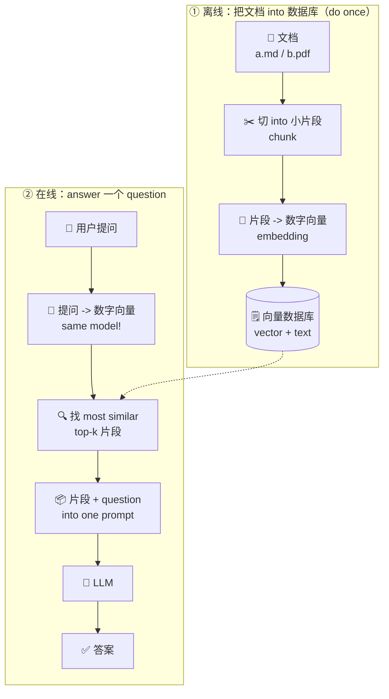
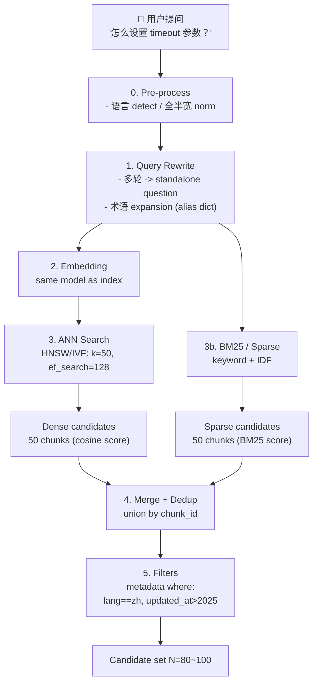
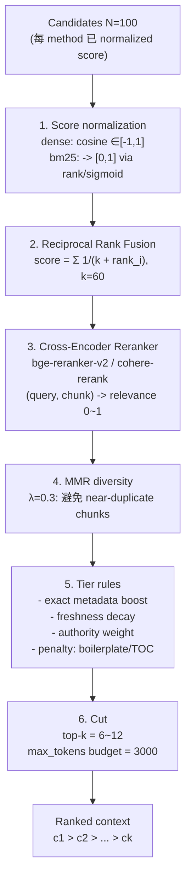
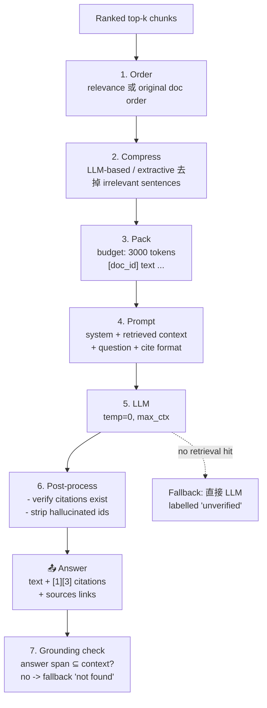
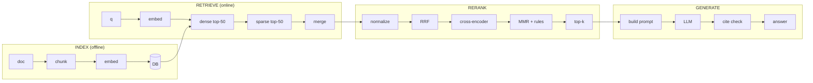

# RAG 链路图（简化版 ·  beginner）

> 一句话：**文档 → 切成小片段 → 片段变成数字 → 提问变成数字 → 找最相似片段 → 片段+提问 into 提示 → LLM 写答案**

---

## 1. 主链路图（only 7 steps）



> 提醒：把把 index 和 query 用 **same embedding model**，否则数字 not comparable。

---

## 2. 7 步 的 plain 中文

| # | Step | 中文 | 为什么 |
| --- | --- | --- | --- |
| 1 | Chunk | 把把 long doc into 小 pieces（~300–500 字） | LLM 不能 read 全部 at once |
| 2 | Embedding | 把把 piece -> long list of numbers（vector） | 数字 = 电脑 can compare |
| 3 | Vector DB | 把把 store all vectors | build once, reuse many |
| 4 | Query embed | 把把 question also -> vector | **must same model** |
| 5 | Search | question vector vs all vectors, pick closest k | similar number = similar meaning |
| 6 | Prompt | pieces + question into one text | LLM only sees this text |
| 7 | Generate | LLM 用 pieces 写 answer | 真实 doc = 少 hallucinate |

---

## 3. 用户提问 → 检索（读取链路）



> 说明：Dense 只抓语义，Sparse 抓 exact term（型号名、错误 code、API 名）；两者 union 才给 robust recall。

---

## 4. 高级排序（Rerank / Re-rank）



### 排序公式（典型组合）

$$
\text{final}(c) \;=\; w_r \cdot \underbrace{\sum_i \frac{1}{k + \text{rank}_i(c)}}_{\text{RRF}} \;+\; w_x \cdot \underbrace{f_{\text{cross-encoder}}(q, c)}_{\text{relevance}} \;+\; w_m \cdot \underbrace{\text{meta}(c)}_{\text{metadata}} \;+\; w_t \cdot \underbrace{e^{-\lambda \Delta t}}_{\text{freshness}}
$$

| 组件 | 输入 | 输出 | 成本 | 备注 |
| --- | --- | --- | --- | --- |
| RRF | 多 retriever 的 rank list | 融合 score | O(N) | 无需 calibration |
| Cross-Encoder | (q, c) 每 pair | 0~1 | O(N) forward passes | 精度最高, 用 N≤100 |
| MMR | vectors + scores | 多样性 filtered | O(N²) | λ 0.2~0.5 |
| Metadata boost | filters/fields | additive | cheap | 需 explicit rules |
| Freshness decay | timestamp | multiplier | cheap | λ = 1/half-life |

---

## 5. Context 组装 → 生成 → 输出



### Prompt 骨架

```text
<system>
You answer ONLY from <context>. Cite with [n]. If absent, say "not in docs".
</system>
<context>
[1] (api_docs.md §3.2, page 12, 2026-08-01)
The timeout parameter defaults to 30s. Set 0 to disable...
[2] (faq.md §7, page 3)
...
</context>
<question>怎么设置 timeout 参数？</question>
<answer> ... [1] ... </answer>
```

---

## 6. 端到单（single pipeline, all stages labelled）



---

## 7. 参数 cheat-sheet（默认值起点）

| Stage | Param | 建议 | 说明 |
| --- | --- | --- | --- |
| Chunk | size / overlap | 400–800 tok / 10–20% | 代码:按函数;表格:keep whole |
| Embed | model dim | 1024 (bge-m3) | 必须 same as query |
| Dense | k / ef_search | 50 / 128 | recall 先, precision 后 |
| Sparse | k | 50 | BM25 top-k |
| Rerank | N in / k out | 100 / 6–12 | cross-encoder 上限 |
| MMR | λ | 0.3 | 0 = 无 diversity |
| Context | token budget | 25–35% of ctx window | 留 room for reasoning |
| Gen | temperature | 0 | deterministic |
| Guard | min relevance | 0.35 | below -> "not found" |

---

## 8. 常见 failure modes → 对应 stage to fix

| 症状 | 诊断 | 修复 stage |
| --- | --- | --- |
| 答案引用错误 page | metadata 丢失 | §2 metadata / §6 cite check |
| 只抓 1 主题, 漏相关 | recall 低 | §3 加 sparse / 加 k |
| 重复 near-dup chunks | no diversity | §4 MMR |
| 表格/代码被割 | bad chunking | §2 structure-aware |
| 旧 info 优先 | no freshness | §4 freshness decay |
| 幻觉 citations | no grounding | §6 grounding check |
| 术语 mismatch | no rewrite | §3 query rewrite |

---

## 9. 复杂度

- Index: $O(N \cdot d)$ embed + $O(N \log N)$ HNSW build
- Query: $O(d)$ embed + $O(\log N + \text{ef})$ ANN + $O(N)$ rerank（dominant）
- Memory: $N \times d \times 4$ bytes（10⁶ × 1024 ≈ 4 GB）

---

## 10. 一句话 checklist（implement order）

1. 先 get **chunking + metadata** right（biggest lever）
2. 再 get **dense + sparse union** recall right
3. 再 add **RRF → cross-encoder**（cheap win）
4. 最后 add **MMR / freshness / cite-guard**（polish）
